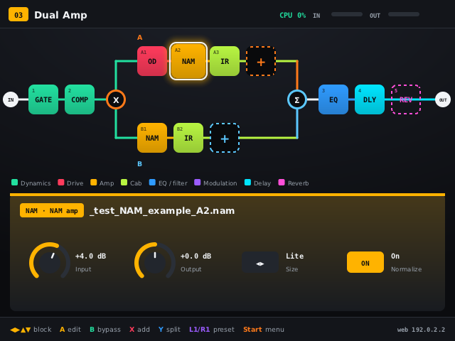
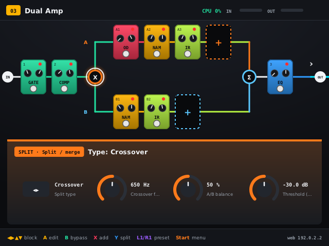

# namfx – NAM kytarový efekt pro R36S

[English](README.md) · **Čeština**

Kytarový multiefekt s Neural Amp Modelerem pro R36S (RK3326, dArkOS).
**Fáze 1:** aplikace se spouští z dArkOS jako port v EmulationStation nebo přes SSH. Systém nemění a běží jen tehdy, když ji spustíš.

- Efektový řetězec s paralelním routingem (split → větve A/B → merge).
- Ovládání přes **web UI z telefonu (WiFi)** a přes **UI na displeji konzole** (tlačítka).
  Obojí funguje současně a obojí funguje i bez displeje.
- Dvě zobrazení rigu (dlaždice nebo pedalboard) a čtyři motivy (tmavý, světlý, vysoký kontrast, retro jantar).
- **Rozšiřitelné efekty:**
  - typy efektů jsou JSON soubory nad vestavěnými enginy
  - volitelně **hostitel LV2 pluginů**
  - viz [Efekty](#efekty)
- Bez kytary a bez vstupního hardwaru: vstup z **WAV souboru** (DI nahrávka) ve smyčce, nebo **offline render** WAV → WAV.
- Jazyky UI: angličtina (výchozí) a čeština. Další jdou přidat přes `web/lang/*.json` (viz [Jazyky](#jazyky)).

## Efekty

Efekty jsou ve třech vrstvách:

1. **Vestavěné bloky:**
   - **NAM** zesilovač (`.nam`, A1/A2, u A2 Lite/Full)
   - **IR** box (`.wav`, libovolné vzorkování, zkrácení 10–500 ms)
   - noise gate, parametrický EQ, tremolo, hlasitost
   - split/merge
2. **Typy efektů** běží na šesti vlastních enginech namfx. Každý typ je JSON soubor: přibalené
   jsou v `fx/`, vlastní patří do `data/fx/`. Nový delay, chorus nebo overdrive je jen nový
   soubor a nic se nekompiluje. Formát a popis enginů: [docs/fx-types.md](docs/fx-types.md).
3. **LV2 pluginy**, které si nainstaluješ sám (např. `sudo apt install guitarix-lv2 x42-plugins`).
   namfx je jen načítá a žádné nedistribuuje. Podrobnosti: [docs/lv2.md](docs/lv2.md).

Přibalené typy efektů (41):

| Kategorie | Typy |
|---|---|
| Dynamika | Kompresor, Opto kompresor, Studiový kompresor, Squash, Limiter |
| Drive | Overdrive (TS/Boost/Fuzz), Green Screamer, Transparent OD, Distortion, Vintage Fuzz, Big Fuzz, Clean Boost, Treble Booster |
| Modulace | Chorus, Analog Chorus, Ensemble, Dimension, Vibrato, Flanger, Jet Flanger, Phaser, Vintage Phase, Deep Phaser, Uni-Vibe |
| Delay | Delay (Digital/Tape), Digital Delay, Analog Delay, Tape Echo, Space Echo (3 hlavy), Ducking Delay, Lo-Fi Delay, Mod Delay, Slapback, Ping-Pong, Ambient Delay |
| Reverb | Reverb (Room/Hall/Plate), Room, Hall, Plate, Tmavý reverb, Ambient |
| Routing | Split: Y, A/B poměr, Crossover (LR 24 dB/okt), Dynamic. Merge: hlasitost, pan, fáze, mono/stereo, automatické zarovnání latence |

Typy `comp`, `drive`, `chorus`, `flanger`, `phaser`, `delay` a `reverb` mají stejné id a parametry
jako v předchozích verzích, takže starší presety se načtou.

Hlavní řetězec se stane stereofonním za prvním stereo blokem (delay, modulace, reverb nebo stereo
LV2 plugin). Větve splitu jsou mono.

Dále: ladička (YIN, A4 430–450 Hz, ztlumení výstupu), scény (zapnutí bloků), presety v JSON.

## Výkon na R36S

Změřeno na R36S (Cortex-A35, jedno jádro, 48 kHz, perioda 128):

| Preset | Zátěž |
|---|---|
| Gate, NAM A2 Lite, IR, EQ, delay, reverb | ~36 % |
| Dual amp: 2× (NAM A2 Lite + IR) v paralelních větvích, kompresor, drive, EQ, delay | ~66–68 % |

| Blok | Zátěž 1 jádra A35 |
|---|---|
| NAM A2 **Lite** | ~22 % |
| NAM A2 **Full** / A1 standard | v reálném čase nestíhá |
| IR 100 ms | ~5 % |
| Typy efektů | po 0,5–8,5 % (zobrazeno v seznamu pro přidání) |

Na R36S používej NAM modely **A2 Lite**. Zátěž každého bloku se za běhu měří. Ukazuje se v editoru
bloku, z ní se počítá odhad CPU celého řetězce a pro každý typ se ukládá do `data/cpu_stats.json`
(seznam pro přidání ji pak ukazuje se ✓). `./build/namfx --bench` změří všechny typy na stroji,
na kterém běží.

## Instalace (SSH na konzoli)

```sh
# na konzoli (uživatel ark), adresář na ext4 kvůli spustitelným souborům
cd ~ && git clone <repo> namfx     # nebo zkopíruj složku namfx
cd ~/namfx
./tools/build.sh                   # apt závislosti, NeuralAmpModelerCore, build (15-30 min)
./tools/install.sh                 # spouštěč do /roms/ports/NAMFX.sh
```

Závislosti: `g++ cmake git pkg-config libasound2-dev libsdl2-dev liblilv-dev lv2-dev` (doinstaluje `build.sh`).
NeuralAmpModelerCore (MIT) se stáhne do `third_party/` (`tools/fetch_deps.sh`). Když nejde
GitLab, vezme se Eigen ze systémového balíčku `libeigen3-dev`.

Konzole má 1 GB RAM. Když systém kompilátor ukončí (Killed), zvětši zram a překládej na jednom jádru:

```sh
sudo systemctl stop emulationstation
sudo swapoff /dev/zram0 && echo 1 | sudo tee /sys/block/zram0/reset
echo 1G | sudo tee /sys/block/zram0/disksize && sudo mkswap /dev/zram0 && sudo swapon /dev/zram0
JOBS=1 ./tools/build.sh
```

Kořenový souborový systém dArkOS je btrfs, swap soubor na něm nefunguje.

## Spuštění

- **EmulationStation → Ports → NAMFX**, nebo přes SSH `/roms/ports/NAMFX.sh`.
- Web UI: `http://<IP konzole>/`. Port 80, nebo 8080, když je 80 obsazený (třeba správcem souborů dArkOS) nebo nepovolený. Adresa je vpravo dole na displeji a v `~/namfx/namfx.log`.
- Ukončení: **Select + Start**, nebo **Start → Ukončit**, nebo `Ctrl+C` / `sudo pkill namfx` přes SSH.

Při spuštění přes SSH dál běží EmulationStation a reaguje na tlačítka. UI na displeji se v tom případě nemusí otevřít (DRM drží ES), web UI funguje.

### Bez kytary (DI nahrávky)

1. Nahraj DI WAV (48 kHz, mono) do `data/wav/` (web UI → Soubory → DI nahrávky, nebo `scp`).
2. Web UI → Systém → Vstup → **WAV soubor** → Přehrát. Hraje ve smyčce přes řetězec do sluchátek.

Offline render bez zvukové karty, i na PC:

```sh
./build/namfx --preset 02_Plexi_Crunch.json --offline moje_di.wav vystup.wav
# vypíše i rychlost: "×realtime" a zátěž jádra
```

### Volby

```
--data DIR --web DIR --fonts DIR   cesty (výchozí ./data ./web ./fonts)
--fx DIR                           přibalené typy efektů (výchozí ./fx)
--no-lv2                           nehledat LV2 pluginy
--no-hotspot                       nikdy nespouštět vlastní WiFi
--lang en|cs                       jazyk UI (jinak z data/settings.json, výchozí en)
--port N                           web server (80 → 8080)
--rate 48000 --block 128           vzorkování a perioda (128 = 2,7 ms)
--capture DEV --playback DEV       ALSA zařízení (výchozí: karta z Systém → Zvukový vstup), --capture '' = bez vstupu
--in-channel 0|1|2                 levý / pravý / součet (výchozí: pravý u interního jacku, levý u USB)
--cpu 3                            jádro audio vlákna (SCHED_FIFO 80)
--null-audio                       bez zvukové karty (test UI)
--no-display                       bez UI na displeji (tlačítka fungují dál)
--preset FILE --wav FILE           výchozí preset / WAV vstup ve smyčce
--offline IN OUT                   render a konec
--snapshots DIR                    PNG všech obrazovek displeje
--bench [SEC]                      změří zátěž všech typů bloků
--print-state / --print-catalog    stav / katalog bloků (JSON) a konec
--print-engines / --print-log      popis enginů / log načítání katalogu a konec
```

## Ovládání tlačítky

| Obrazovka | Tlačítka |
|---|---|
| Rig | D-pad = výběr bloku (▲▼ přepíná větve A/B), **A** upravit, **B** bypass, **X** přidat blok, **Y** split/merge, **L1/R1** preset, **L2/R2** scéna, **Select** ladička, **Start** menu |
| Úprava bloku | ▲▼ parametr, ◀▶ hodnota (držet = rychle), L1/R1 hrubě, **A** na řádku souboru = výběr modelu/IR, X bypass, B zpět |
| Přidat blok | ◀▶ kategorie / seznam, ▲▼ posun, L1/R1 stránka, **Y** filtr zdroje (vše, vestavěné, vlastní typy, LV2), **A** vložit, **B** zpět |
| Ladička | ◀▶ A4, A ztlumit/pustit výstup, B zpět |
| Menu | uložit/načíst preset, posun a mazání bloku, WAV vstup, jazyk, motiv, zobrazení rigu (dlaždice / pedalboard), vlastní WiFi (Auto / Vždy / Vypnuto), ukončit |

Klávesnice (běh na PC v okně): šipky, Enter=A, Esc=B, X, Y, Q/W=L1/R1, 1/2=L2/R2, Tab=Select, mezerník=Start.

## Vzhled

- **Zobrazení rigu:** *Dlaždice* (kompaktní řetězec) nebo *Pedalboard* (každý blok jako pedál
  s LED, knoby a footswitchem; větve splitu ve dvou řadách).
- **Motivy:** tmavý, světlý, vysoký kontrast, retro jantar. Barvy kategorií zůstávají stejné.

Nastavení: web UI (Systém → Vzhled; tlačítko ▦ na záložce Rig přepíná zobrazení) nebo konzole
(Start → Motiv / Zobrazení rigu). Ukládá se do `data/settings.json`.

## Vlastní WiFi (hotspot)

Když konzole není připojená k žádné WiFi, namfx otevře vlastní síť, aby web UI zůstalo dostupné
z telefonu. Používá NetworkManager (`nmcli device wifi hotspot`); WiFi čip musí umět režim AP
(`iw list` → *Supported interface modes: AP*).

- **Auto** (výchozí): 20 s bez WiFi připojení → vlastní síť.
- **Vždy:** vlastní síť po celou dobu běhu namfx (konzole opustí běžnou WiFi).
- **Vypnuto:** nikdy.

Výchozí síť `namfx`, heslo `namfx1234`. Připoj telefon a otevři `http://10.42.0.1` (adresa je
i vpravo dole na obrazovce konzole). Režim, název a heslo se nastavují ve web UI (Systém → Síť,
tam i *Spustit / Zastavit hotspot teď*) nebo na konzoli (Start → Vlastní WiFi) a ukládají se do
`data/settings.json`. Po ukončení namfx se hotspot vypne a NetworkManager se znovu připojí ke
známým sítím. Ovládání NetworkManageru potřebuje root, který spouštěč z Ports má; `--no-hotspot`
funkci úplně vypne.

**Heslo k webu (volitelné).** Webové UI, WebSocket i nahrávání souborů jsou ve výchozím stavu bez hesla,
což je doma v pořádku, ale ne ve sdílené síti nebo na hotspotu. Přidejte do `data/settings.json`
`"web_password": "vaše heslo"` a namfx restartujte: prohlížeč se pak zeptá na přihlášení (uživatel `namfx`
a toto heslo).

## Zvukový vstup

Zvukovou kartu vyberete ve webu (Systém → Zvukový vstup) nebo na konzoli (Start → Zvukový vstup):

- **Auto** (výchozí): USB rozhraní (třeba TC Helicon GO Twin), pokud je připojené, jinak interní kodek.
- **Interní:** vstup R36S.
- **USB: název:** konkrétní rozhraní.

Vstup a výstup vždy používají stejnou kartu, protože dvě karty mají každá své hodiny a rozcházejí se.
Vstupní kanál je výchozí *Auto*: pravý u interního jacku (signál je jen tam), levý u USB; můžete vynutit
levý, pravý nebo součet. Změna na chvíli restartuje zvuk. USB rozhraní připojte před spuštěním namfx, nebo
stiskněte *Vyhledat zvukové karty* a vyberte ho. Volbu přebíjí `--capture`, `--playback` a `--in-channel`
(stránka to napíše). Interní jack je mikrofonní vstup, ne kytarový; pro kytaru použijte USB rozhraní.
Volba se ukládá do `data/settings.json`.

## Jazyky

Výchozí jazyk aplikace je angličtina, k dispozici je i čeština. Jazyk se přepíná ve web UI (Systém → Jazyk) nebo na konzoli (Start → Jazyk). Volba se uloží do `data/settings.json` a platí pro web i displej.

Překlady leží v `web/lang/<kód>.json` a jsou společné pro web UI i UI na displeji.

Nový jazyk:
1. Zkopíruj `web/lang/en.json` do `web/lang/de.json` (a podobně).
2. Nastav `"_language": "Deutsch"`.
3. Přelož hodnoty. `fmt.decimal` je desetinný oddělovač, `note.B` je název tónu (čeština „H“).

Chybějící klíč se zobrazí anglicky. `tools/i18n.py` přegeneruje `en.json` ze zdrojáků a vypíše chybějící klíče ostatních jazyků (`--check` pro CI). Vlastní typy efektů můžou mít vlastní překlady v poli `tr`.

## Soubory

```
data/nam/       *.nam  (TONE3000 – vybírej A2, na R36S Lite)
data/ir/        *.wav  (IR boxu, mono/stereo, libovolné vzorkování)
data/wav/       *.wav  (DI nahrávky pro vstup bez kytary)
data/presets/   *.json (presety; poslední použitý se načte po startu)
data/fx/        *.json (vlastní typy efektů)
data/lv2/       *.lv2  (vlastní LV2 balíčky, ARM64)
data/settings.json      jazyk, motiv, zobrazení
data/cpu_stats.json     naměřená zátěž typů bloků
```

Přiložená testovací data: `_test_NAM_example_A2.nam` a `_test_NAM_example_A1.nam` (ukázkové modely z NeuralAmpModelerCore, ne reálné zesilovače), `synth_4x12_test.wav` (syntetická IR), `nam_example_di.wav` (ukázkový DI signál z NeuralAmpModelerCore), `test_tone_A2_110Hz.wav` (test ladičky).

Zdroje modelů a IR: [TONE3000](https://www.tone3000.com) (NAM A2 + IR), God's Cab od Signals Audio (free IR Mesa OS 4x12).

## Formát presetu

```json
{
  "name": "Dual Amp", "input_gain": 0, "output_gain": -4,
  "chain": [
    {"id": "b1", "type": "gate", "on": true, "params": {"thresh": -60}},
    {"id": "b3", "type": "split", "params": {"mode": 2, "freq": 650, "levelB": -6, "panA": -60, "panB": 60, "stereo": 1},
     "a": [{"id": "b11", "type": "nam", "file": "plexi_a2lite.nam", "params": {"size": 0}},
           {"id": "b12", "type": "ir", "file": "v30_sm57.wav"}],
     "b": [{"id": "b20", "type": "nam", "file": "twin_a2lite.nam"}]},
    {"id": "b5", "type": "delay_tape", "params": {"time": 380, "age": 6}},
    {"id": "b6", "type": "lv2:http://guitarix.sourceforge.net/plugins/gx_reverb_stereo#_reverb_stereo", "params": {}}
  ],
  "scenes": [{"name": "Lead", "on": {"b5": true}}], "scene": 0
}
```

Blok, jehož typ tu není k dispozici (chybí soubor typu nebo LV2 plugin), se načte jako průchozí zástupce a jeho nastavení zůstane zachované.

## API (WebSocket `/ws`, JSON)

Příkazy `{"cmd": …}`:
- **stav a katalog:** `state`, `catalog`
- **bloky:** `set_param {id,param,value}`, `set_on {id,on}`, `set_file {id,file}`, `add_block {type, after | lane:{split,lane}}`, `add_split {after}`, `remove {id}`, `move {id,dir}`, `move_to_lane {id,lane:a|b|main,split}`
- **presety a scény:** `preset_load/save/new/rename`, `scene_store/select/remove`
- **nastavení a vstup:** `set_global {key,value}`, `tuner {on}`, `input {source:live|wav,file,loop,play}`, `transport {play,rewind}`, `set_lang {lang}`, `set_ui {theme,view}`
- **síť:** `net_set {mode:auto|always|off, ssid, password}`, `net_hotspot {on}`; `state.network` (stav) a `state.hotspot_cfg`
- **audio:** `audio_set {device:auto|internal|card:ID, channel:auto|left|right|sum}`, `audio_scan`; `state.audio_dev` (karty, aktivní vstup, volba, manual); `metronome {on?, bpm 30-300, volume dB}` (klik přimíchaný za efekty, `state.metronome`; web: System → Metronom s tap tempem), `undo` / `redo` (strukturální úpravy: přidání, odebrání, posun, bypass, výměna souboru; posledních 30; `state.can_undo`/`can_redo`), `mute {on?}` nouzové ztlumení (výstup se plynule ztlumí, bez `on` přepíná), `state.muted`; `status` má také `in_l_db` / `in_r_db` (surové špičky vstupu po kanálech)
- **katalog efektů:** `fx_rescan`, `catalog_log`, `engines`

Server posílá `state` (při změně) a `status` (10×/s: CPU, úrovně, zátěž bloků `loads`, ladička). Při změně katalogu se změní `state.catalog_version`.
Chyby mají tvar `{"ok":false,"code":"err.…","error":"anglický text"}`, UI překládá podle `code`.

HTTP:
- `GET /api/state`
- `POST /api/upload?kind=nam|ir|wav|presets|fx&name=…` (tělo = soubor)
- `POST /api/delete?kind=…&name=…`

## Architektura

```
ALSA capture ─┐                          ┌─ web server (HTTP + WebSocket, vlákno)
WAV soubor ───┼─► Engine::process ──► ALSA│  UI na displeji (SDL2/KMSDRM, software render)
              │   (audio vlákno, jádro 3,  │  gamepad (evdev)
              │    SCHED_FIFO, bez alokací)└─ řídicí smyčka: Engine::handle (mutex), výměna grafu
```

- Graf řetězce je neměnný objekt. Při změně struktury vznikne nový a předá se audio vláknu lock-free (`Swap<T>`). Uvolňuje ho řídicí vlákno.
- Parametry jsou atomické a vyhlazené. Bypass má 10ms přechod.
- NAM modely, IR a instance LV2 se načítají v řídicím vlákně a vyměňují se bez výpadku.
- IR: uniformně dělená FFT konvoluce, oddíl = perioda, bez přidané latence.
- Katalog (`src/dsp/catalog.cpp`): vestavěné bloky + typy efektů (`src/dsp/engines.cpp`) + LV2 (`src/dsp/lv2_host.cpp`, lilv).

## Stav

Ověřeno na R36S (dArkOS, Debian trixie):
- build na konzoli
- ALSA 48 kHz / perioda 128 / `hw:0,0`
- displej z Ports
- gamepad
- web UI
- naměřená zátěž (viz výše)

Ověřeno na PC:
- offline render všech typů efektů (úrovně, konečné hodnoty, bez ořezu ve výchozím nastavení)
- LV2 hostitel s testovacími pluginy: mono/stereo, přepínače, výčty, celočíselné a log porty, `lv2:enabled`, atom porty, options, přeskočení pluginů s worker/CV
- WebSocket API včetně vlastních balíčků typů, zástupců chybějících typů a `set_ui`
- fuzzing API pod ASan a TSan
- web UI v prohlížeči a snapshoty UI displeje ve všech motivech
- stavový automat hotspotu (auto / vždy / vypnuto, ruční start/stop, přejmenování za běhu) proti simulovanému `nmcli`

Ještě neověřeno na R36S:
- skutečné LV2 balíčky (guitarix, x42)
- naměřená zátěž nových typů efektů (ukáže se po použití)
- hotspot se skutečným WiFi čipem

## Licence

namfx má **dvojí licenci**: [GPL-3.0-only](LICENSE), nebo komerční licenci od autora pro použití
v uzavřeném software (viz [COMMERCIAL.md](COMMERCIAL.md)). Příspěvky vyžadují
[CLA](CLA.md). Komponenty třetích stran: [THIRD_PARTY.md](THIRD_PARTY.md). NAM modely, IR a LV2
pluginy nejsou součástí namfx.

## Obrazovky

Displej konzole (`--snapshots docs/screen`): `docs/screen/*.png`. Web UI: `docs/web/*.png`.



