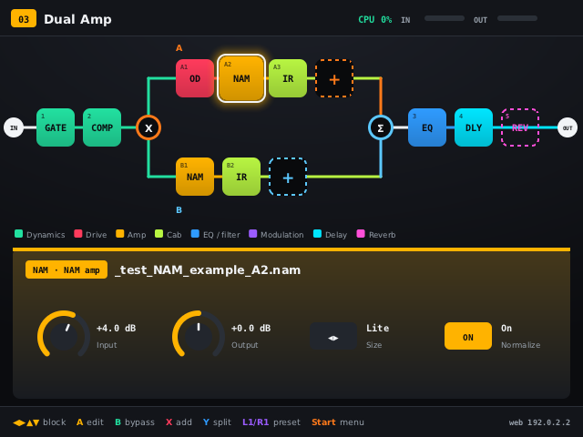
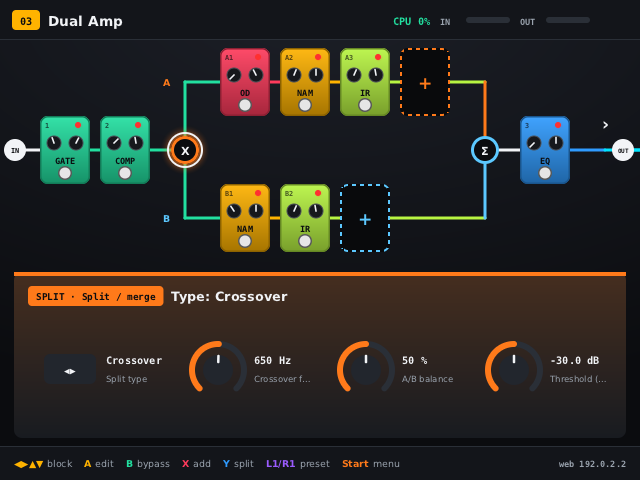

# namfx – NAM guitar effect for the R36S

**English** · [Čeština](README.cs.md)

A guitar multi-effect built around Neural Amp Modeler for the R36S handheld (RK3326, dArkOS).
**Phase 1:** it runs as an app on stock dArkOS. Launch it as a port from EmulationStation or over SSH; it changes nothing in the system and runs only while you use it.

- Effect chain with parallel routing (split → paths A/B → merge).
- Control via a **web UI on your phone (WiFi)** and an **on-screen UI** driven by the console buttons.
  Both work at the same time, and both work without a display.
- Two rig views (tiles or pedalboard) and four themes (dark, light, high contrast, retro amber).
- **Extensible effects:**
  - effect types are JSON files on built-in engines
  - optional **LV2 plugin host**
  - see [Effects](#effects)
- No guitar or input hardware needed: loop a **WAV file** (DI recording) as the input, or **render offline** WAV → WAV.
- UI languages: English (default) and Czech. More can be added via `web/lang/*.json` (see [Languages](#languages)).

## Effects

Effects come in three layers:

1. **Built-in blocks**:
   - **NAM** amp (`.nam`, A1/A2, Lite/Full for A2)
   - **IR** cab (`.wav`, any rate, trimmed to 10–500 ms)
   - noise gate, parametric EQ, tremolo, volume
   - split/merge
2. **Effect types** run on six engines written for namfx. Each type is a JSON file: the bundled
   ones are in `fx/`, your own go in `data/fx/`. A new delay, chorus or overdrive is a new file
   and needs no compilation. Format and engine reference: [docs/fx-types.md](docs/fx-types.md).
3. **LV2 plugins** that you install yourself (e.g. `sudo apt install guitarix-lv2 x42-plugins`).
   namfx only loads them and distributes none. Details: [docs/lv2.md](docs/lv2.md).

Bundled effect types (41):

| Category | Types |
|---|---|
| Dynamics | Compressor, Opto Compressor, Studio Compressor, Squash, Limiter |
| Drive | Overdrive (TS/Boost/Fuzz), Green Screamer, Transparent OD, Distortion, Vintage Fuzz, Big Fuzz, Clean Boost, Treble Booster |
| Modulation | Chorus, Analog Chorus, Ensemble, Dimension, Vibrato, Flanger, Jet Flanger, Phaser, Vintage Phase, Deep Phaser, Uni-Vibe |
| Delay | Delay (Digital/Tape), Digital Delay, Analog Delay, Tape Echo, Space Echo (3 heads), Ducking Delay, Lo-Fi Delay, Mod Delay, Slapback, Ping-Pong, Ambient Delay |
| Reverb | Reverb (Room/Hall/Plate), Room, Hall, Plate, Dark Reverb, Ambient |
| Routing | Split: Y, A/B balance, Crossover (LR 24 dB/oct), Dynamic. Merge: level, pan, phase, mono/stereo, automatic latency alignment |

The types `comp`, `drive`, `chorus`, `flanger`, `phaser`, `delay` and `reverb` keep the ids and
parameters of earlier versions, so old presets still load.

The main chain becomes stereo after the first stereo block (delay, modulation, reverb or a stereo
LV2 plugin). Split paths are mono.

Plus a tuner (YIN, A4 430–450 Hz, output mute), scenes (block on/off snapshots) and JSON presets.

## Performance on the R36S

Measured on the R36S (Cortex-A35, one core, 48 kHz, period 128):

| Preset | Load |
|---|---|
| Gate, NAM A2 Lite, IR, EQ, delay, reverb | ~36 % |
| Dual amp: 2× (NAM A2 Lite + IR) in parallel paths, comp, drive, EQ, delay | ~66–68 % |

| Block | Load on one A35 core |
|---|---|
| NAM A2 **Lite** | ~22 % |
| NAM A2 **Full** / A1 standard | does not run in real time |
| IR 100 ms | ~5 % |
| Effect types | 0.5–8.5 % each (shown in the add list) |

Use **A2 Lite** NAM models on the R36S. Every block's load is measured while it runs. The value
is shown in the block editor, used for the chain's CPU estimate, and remembered per type in
`data/cpu_stats.json` (the add list then shows it with ✓). `./build/namfx --bench` measures every
type on the machine it runs on.

## Installation (SSH on the console)

```sh
# on the console (user ark); use an ext4 directory so files can be executable
cd ~ && git clone <repo> namfx     # or copy the namfx folder
cd ~/namfx
./tools/build.sh                   # apt deps, NeuralAmpModelerCore, build (15-30 min)
./tools/install.sh                 # launcher to /roms/ports/NAMFX.sh
```

Dependencies: `g++ cmake git pkg-config libasound2-dev libsdl2-dev liblilv-dev lv2-dev` (`build.sh` installs them).
NeuralAmpModelerCore (MIT) is fetched into `third_party/` by `tools/fetch_deps.sh`. If GitLab is
down, Eigen is taken from the system package `libeigen3-dev`.

The console has 1 GB of RAM. If the compiler gets killed, enlarge zram and build on one core:

```sh
sudo systemctl stop emulationstation
sudo swapoff /dev/zram0 && echo 1 | sudo tee /sys/block/zram0/reset
echo 1G | sudo tee /sys/block/zram0/disksize && sudo mkswap /dev/zram0 && sudo swapon /dev/zram0
JOBS=1 ./tools/build.sh
```

The root filesystem of dArkOS is btrfs, so a swap file does not work there.

## Running

- Start it from **EmulationStation → Ports → NAMFX**, or over SSH with `/roms/ports/NAMFX.sh`.
- Open the web UI at `http://<console IP>/`. It uses port 80, or 8080 when port 80 is taken (e.g. by the dArkOS file browser) or not allowed. The address is shown in the bottom right of the screen and in `~/namfx/namfx.log`.
- Quit with **Select + Start**, **Start → Quit**, or `Ctrl+C` / `sudo pkill namfx` over SSH.

When started over SSH, EmulationStation keeps running and still reacts to the buttons. The on-screen UI may then fail to open because ES holds the DRM device; the web UI still works.

### Without a guitar (DI recordings)

1. Put DI WAV files (48 kHz, mono) into `data/wav/`, either via the web UI (Files → DI recordings) or with `scp`.
2. In the web UI go to System → Input → **WAV file** → Play. The file loops through the chain to the headphones.

Offline rendering needs no sound card and also works on a PC:

```sh
./build/namfx --preset 02_Plexi_Crunch.json --offline my_di.wav out.wav
# also prints speed ("x realtime") and core load
```

### Options

```
--data DIR --web DIR --fonts DIR   paths (default ./data ./web ./fonts)
--fx DIR                           bundled effect types (default ./fx)
--no-lv2                           do not scan LV2 plugins
--no-hotspot                       never open the WiFi hotspot
--lang en|cs                       UI language (else data/settings.json, default en)
--port N                           web server (80 -> 8080)
--rate 48000 --block 128           sample rate and period (128 = 2.7 ms)
--capture DEV --playback DEV       ALSA devices (default: the card from System -> Audio input), --capture '' = no input
--in-channel 0|1|2                 left / right / sum (default: right for the internal jack, left for USB)
--cpu 3                            audio thread core (SCHED_FIFO 80)
--null-audio                       no sound card (UI testing)
--no-display                       no on-screen UI (buttons still work)
--preset FILE --wav FILE           start preset / looped WAV input
--offline IN OUT                   render and exit
--snapshots DIR                    PNGs of all on-screen UI pages
--bench [SEC]                      measure the load of every block type
--print-state / --print-catalog    state / block catalog as JSON, then exit
--print-engines / --print-log      engine reference / catalog load log, then exit
```

## Buttons

| Screen | Buttons |
|---|---|
| Rig | **D-pad** select block (▲▼ switches paths A/B), **A** edit, **B** bypass, **X** add block, **Y** split/merge, **L1/R1** preset, **L2/R2** scene, **Select** tuner, **Start** menu |
| Edit block | **▲▼** parameter, **◀▶** value (hold = fast), **L1/R1** coarse, **A** on the file row picks a model/IR, **X** bypass, **B** back |
| Add block | **◀▶** categories / list, **▲▼** move, **L1/R1** page, **Y** source filter (all, built-in, my types, LV2), **A** insert, **B** back |
| Tuner | **◀▶** A4, **A** mute/unmute output, **B** back |
| Menu | save/load preset, move/delete block, WAV input, language, theme, rig view (tiles / pedalboard), own WiFi (Auto / Always / Off), quit |

Keyboard (PC window): arrows, Enter=A, Esc=B, X, Y, Q/W=L1/R1, 1/2=L2/R2, Tab=Select, Space=Start.

## Appearance

- **Rig view:** *Tiles* (compact chain) or *Pedalboard* (every block drawn as a pedal with LED,
  knobs and footswitch; split paths shown as two rows).
- **Themes:** Dark, Light, High contrast, Retro amber. Category colours stay the same in every theme.

Set them in the web UI (System → Appearance; the ▦ button on the Rig tab switches the view) or on
the console (Start → Theme / Rig view). Both are stored in `data/settings.json`.

## Own WiFi (hotspot)

When the console is not connected to any WiFi, namfx opens its own network so the web UI stays
reachable from a phone. It uses NetworkManager (`nmcli device wifi hotspot`); the WiFi chip must
support AP mode (`iw list` → *Supported interface modes: AP*).

- **Auto** (default): no WiFi connection for 20 s → own network.
- **Always:** own network whenever namfx runs (the console leaves its normal WiFi).
- **Off:** never.

Default network `namfx`, password `namfx1234`. Connect the phone and open `http://10.42.0.1`
(the address is also in the bottom right of the console screen). Mode, name and password are set
in the web UI (System → Network, also *Start / Stop hotspot now*) or on the console
(Start → Own WiFi) and stored in `data/settings.json`. The hotspot stops when namfx quits and
NetworkManager reconnects to known networks. Controlling NetworkManager needs root, which the
Ports launcher has; `--no-hotspot` turns the feature off completely.

## Audio input

Pick the sound card in the web UI (System → Audio input) or on the console (Start → Audio input):

- **Auto** (default): a USB interface (for example the TC Helicon GO Twin) when one is plugged in, otherwise the internal codec.
- **Internal:** the R36S input.
- **USB: name:** one specific interface.

Input and output always use the same card, because two cards have separate clocks and drift apart. The
input channel is *Auto* by default: the right channel for the internal jack (it only carries signal
there), the left channel for USB; you can force left, right or the sum. A change restarts the audio for a
moment. Plug the interface in before starting namfx, or press *Look for sound cards* and pick it.
`--capture`, `--playback` and `--in-channel` override the choice (the page says so). The internal jack is a
microphone input, not a guitar input; use a USB interface for the guitar. The choice is stored in
`data/settings.json`.

## Languages

English is the source language. Every string in the code carries its English text and a key, and translations live in `web/lang/<code>.json`. The web UI and the on-screen UI share these files.

You can switch the language in the web UI (System → Language) or on the console (Start → Language). The choice is stored in `data/settings.json`.

To add a language:
1. Copy `web/lang/en.json` to e.g. `web/lang/de.json`.
2. Set `"_language": "Deutsch"`.
3. Translate the values. `fmt.decimal` is the decimal separator; `note.B` is the note name (Czech uses "H").

Missing keys fall back to English. `tools/i18n.py` regenerates `en.json` from the sources and lists the keys each language is missing (`--check` for CI). User effect types can carry their own translations in their `tr` field.

## Files

```
data/nam/       *.nam  (TONE3000 – pick A2, Lite on the R36S)
data/ir/        *.wav  (cab IRs, mono/stereo, any sample rate)
data/wav/       *.wav  (DI recordings for input without a guitar)
data/presets/   *.json (presets; the last used one loads at start)
data/fx/        *.json (your effect types)
data/lv2/       *.lv2  (your LV2 bundles, ARM64)
data/settings.json      language, theme, view
data/cpu_stats.json     measured load per block type
```

Included test data:

| File | What it is |
|---|---|
| `_test_NAM_example_A2.nam`, `_test_NAM_example_A1.nam` | example models from NeuralAmpModelerCore, not real amps |
| `synth_4x12_test.wav` | synthetic IR |
| `nam_example_di.wav` | example DI signal from NeuralAmpModelerCore |
| `test_tone_A2_110Hz.wav` | tuner test tone |

Model and IR sources: [TONE3000](https://www.tone3000.com) (NAM A2 + IRs) and God's Cab by Signals Audio (free Mesa OS 4x12 IRs).

## Preset format

```json
{
  "name": "Dual Amp", "input_gain": 0, "output_gain": -4,
  "chain": [
    {"id": "b1", "type": "gate", "on": true, "params": {"thresh": -60}},
    {"id": "b3", "type": "split", "params": {"mode": 2, "freq": 650, "levelB": -6, "panA": -60, "panB": 60, "stereo": 1},
     "a": [{"id": "b11", "type": "nam", "file": "plexi_a2lite.nam", "params": {"size": 0}},
           {"id": "b12", "type": "ir", "file": "v30_sm57.wav"}],
     "b": [{"id": "b20", "type": "nam", "file": "twin_a2lite.nam"}]},
    {"id": "b5", "type": "delay_tape", "params": {"time": 380, "age": 6}},
    {"id": "b6", "type": "lv2:http://guitarix.sourceforge.net/plugins/gx_reverb_stereo#_reverb_stereo", "params": {}}
  ],
  "scenes": [{"name": "Lead", "on": {"b5": true}}], "scene": 0
}
```

A block whose type isn't available (missing type file or LV2 plugin) loads as a pass-through placeholder and keeps its settings.

## API (WebSocket `/ws`, JSON)

Commands are sent as `{"cmd": …}`:
- **state:** `state`, `catalog`
- **blocks:** `set_param {id,param,value}`, `set_on {id,on}`, `set_file {id,file}`, `add_block {type, after | lane:{split,lane}}`, `add_split {after}`, `remove {id}`, `move {id,dir}`, `move_to_lane {id,lane:a|b|main,split}`
- **presets and scenes:** `preset_load/save/new/rename`, `scene_store/select/remove`
- **settings and input:** `set_global {key,value}`, `tuner {on}`, `input {source:live|wav,file,loop,play}`, `transport {play,rewind}`, `set_lang {lang}`, `set_ui {theme,view}`
- **network:** `net_set {mode:auto|always|off, ssid, password}`, `net_hotspot {on}`; `state.network` (status) and `state.hotspot_cfg`
- **audio:** `audio_set {device:auto|internal|card:ID, channel:auto|left|right|sum}`, `audio_scan`; `state.audio_dev` (cards, active input, choice, manual)
- **effect catalog:** `fx_rescan`, `catalog_log`, `engines`

The server pushes `state` on every change and `status` 10× per second (CPU, levels, per-block load `loads`, tuner). When the catalog changes, `state.catalog_version` changes.
Errors look like `{"ok":false,"code":"err.…","error":"English text"}`; the UIs translate them by `code`.

HTTP endpoints:
- `GET /api/state`
- `POST /api/upload?kind=nam|ir|wav|presets|fx&name=…` (body = file)
- `POST /api/delete?kind=…&name=…`

## Architecture

```
ALSA capture ─┐                          ┌─ web server (HTTP + WebSocket, own thread)
WAV file ─────┼─► Engine::process ──► ALSA│  on-screen UI (SDL2/KMSDRM, software renderer)
              │   (audio thread, core 3,   │  gamepad (evdev)
              │    SCHED_FIFO, no allocs)  └─ control loop: Engine::handle (mutex), graph swaps
```

- The chain graph is immutable. A structural change builds a new graph, which is handed to the audio thread lock-free (`Swap<T>`); the control thread frees the old one.
- Parameters are atomic and smoothed. Bypass uses a 10 ms crossfade.
- NAM models, IRs and LV2 instances load on the control thread and swap in without dropouts.
- The IR block uses uniformly partitioned FFT convolution with partition = period, so it adds no latency.
- Catalog (`src/dsp/catalog.cpp`): built-in blocks + effect types (`src/dsp/engines.cpp`) + LV2 (`src/dsp/lv2_host.cpp`, lilv).

## Status

Verified on the R36S (dArkOS, Debian trixie):
- build on the console
- ALSA 48 kHz / period 128 / `hw:0,0`
- display output from Ports
- gamepad
- web UI
- measured load (see above)

Verified on a PC:
- every effect type rendered offline (levels, finite output, no clipping at defaults)
- LV2 host with test plugins: mono/stereo, toggles, enums, integer and log ports, `lv2:enabled`, atom ports, options feature, skipped worker/CV plugins
- WebSocket API including user type packs, missing-type placeholders and `set_ui`
- API fuzzing under ASan and TSan
- web UI in a browser and on-screen UI snapshots in all themes
- hotspot state machine (auto / always / off, manual start/stop, rename while running) against a simulated `nmcli`

Not yet verified on the R36S:
- real LV2 packages (guitarix, x42)
- measured loads of the new effect types (shown once used)
- hotspot with the real WiFi chip

## License

namfx is **dual-licensed**: [GPL-3.0-only](LICENSE), or a commercial license from the author for
closed-source use (see [COMMERCIAL.md](COMMERCIAL.md)). Contributions require the
[CLA](CLA.md). Third-party components: [THIRD_PARTY.md](THIRD_PARTY.md). NAM models, IRs and LV2
plugins are not part of namfx.

## Screenshots

On-screen UI (`--snapshots docs/screen`): `docs/screen/*.png`. Web UI: `docs/web/*.png`.



